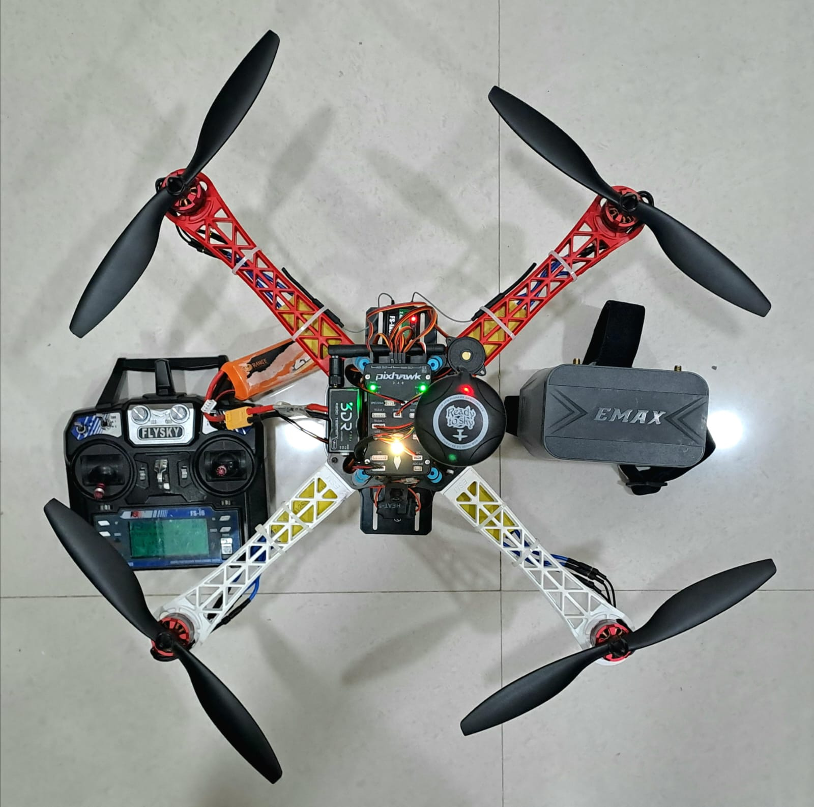
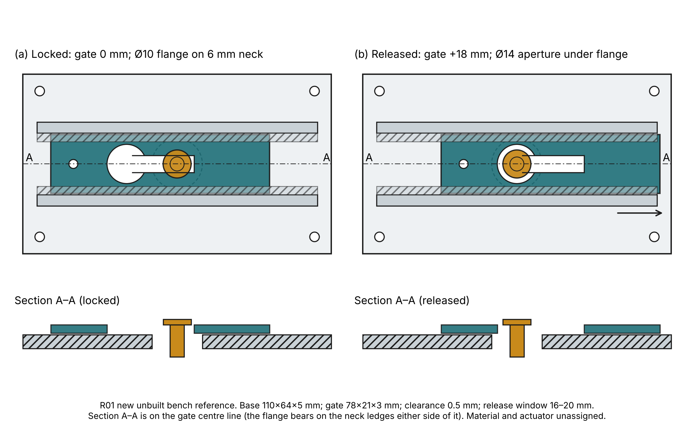

# SkyRelief — mechanical hardware

Supplement **S1** to the manuscript *SkyRelief: A Human-Supervised Dual-UAV Delivery Prototype with Mission-Architecture Analysis* (A. Jalan, A. Patro; candidate for MDPI *Hardware*, not yet submitted). Electronics are in the companion repository, [SkyRelief-Electronics-Integration-Repository](https://github.com/Aarav-J-10/SkyRelief-Electronics-Integration-Repository) (S2).

**What this repository lets you do.** Regenerate, inspect and audit **R01**, a new, unbuilt keyhole-gate payload-release bench mechanism with editable source. Read the surviving records of the two SkyRelief aircraft (a manually piloted FPV Scout UAV and a Pixhawk-based Delivery UAV) that were built and flown in 2024–2025.

**What it does not let you do.** Rebuild the historical aircraft exactly. Their frame CAD is withheld for rights reasons, their latch was never drawn, and their controller configurations were not recovered. R01 is a post hoc reference; it was never fitted to either aircraft.

| Delivery UAV (historical photograph `pld25`) | R01 bench reference (new, generated from source) |
|---|---|
|  |  |

## Reproduce in 5 minutes

```bash
git clone https://github.com/Aarav-J-10/Skyrelief-Hardware-Repo && cd Skyrelief-Hardware-Repo
python -m venv .venv && . .venv/bin/activate          # Python 3.11+
pip install -r requirements-cad.txt                   # cadquery-ocp 8.0.1.1.0, matplotlib
python cad/independently_authored/build_reference.py  # 5 STEP files, byte-identical to the committed ones
python scripts/independent_step_audit.py              # 26 geometry checks incl. the 16–20 mm release window
python scripts/validate_repository.py                 # file, link, hash, BOM and quote-arithmetic checks
python scripts/release_gate.py                        # rights screen of the tree and Git history
```

On Windows use `.venv\Scripts\activate`. Every command is also run by [CI](.github/workflows/verify.yml).

## Contents

| Area | Start here |
|---|---|
| R01 design | [Design definition](docs/R01_Design_Definition.md) · [Generator and parameters](docs/R01_Generator_and_Parameters.md) · [Design analysis](docs/Design_Analysis.md) · source [`cad/independently_authored/`](cad/independently_authored/) · drawings [`drawings/`](drawings/) |
| Building | [Assembly instructions](docs/Assembly_Instructions.md) (historical record + R01 bench procedure) · [Manufacturing and safety](docs/05_Manufacturing_and_Safety.md) |
| Parts and cost | [Build costs](docs/Build_Costs.md) · [`bom/`](bom/) (34-entry crosswalk, 20 dated quotes) · [Third-party components](docs/Manufacturer_or_Third_Party_Integration.md) |
| Aircraft records | [System architecture](docs/Mechanical_System_Architecture.md) · [Photo map](docs/Photo_Map.md) · [Historical data](docs/Historical_Data_Interpretation.md) · [`evidence/original/`](evidence/original/) |
| Verification | [Mechanical verification report](docs/Mechanical_Verification_Report.md) · [`verification/`](verification/) |
| Provenance and rights | [Rights disposition](docs/Source_Rights_Disposition.md) · [`LICENSE_MATRIX.csv`](LICENSE_MATRIX.csv) · [Excluded CAD](docs/EXCLUDED_THIRD_PARTY_CAD.md) · [Source register](docs/Source_Document_Register.md) |
| Release status | [Publication gate](PUBLICATION_GATE.md) · [Release lock](PUBLICATION_RELEASE_LOCK.json) · [Release notes](RELEASE_NOTES.md) |

## Status and licence

Release candidate **0.2.0-rc1**, untagged. **No reuse licence has been granted yet**: both authors must choose one ([decision sheet](AUTHORS_LICENSING_APPROVAL_REQUIRED.md)). Until then the files are published with the authors' consent but are not open-licensed; see [LICENSES.md](LICENSES.md). Five historical STEP files (D01–D05) are withheld. No new physical tests were performed; R01 is **bench-only and not validated for flight**.

Cite with [CITATION.cff](CITATION.cff). Historical source archive: [Shadowfax0707/project-ap-DDPDS_2024_1729-0707](https://github.com/Shadowfax0707/project-ap-DDPDS_2024_1729-0707) at `42f9a44600351ec6d0a57fb20756c547acf38cad`.
